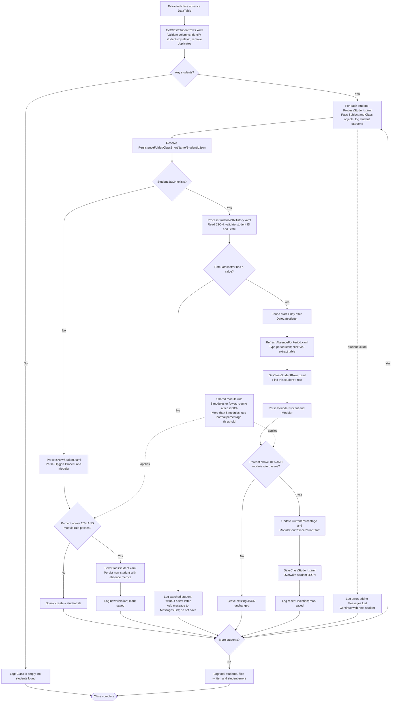
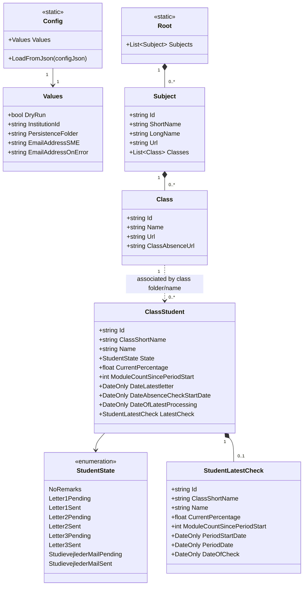

# Lectio absence monitoring — current system

Source snapshot: 2026-11-23. This document describes the workflows and C# models currently on disk, including active test restrictions. Entry point: `Main/Main.xaml`.

## Main orchestration and hierarchy

```mermaid
flowchart TD
    Start([Start]) --> Config["ReadConfigValues.xaml<br/>Read configuration asset; initialize Config.Values"]
    Assets[("Orchestrator assets<br/>LOK2239 Config<br/>LOK2239 LectioCredentials")]
    Assets -. configuration .-> Config
    Config --> Access["Verify persistence-folder write access"]
    Access --> Browser["Open Lectio in Chrome<br/>InstitutionId from configuration"]
    Browser --> Logout["EnsureLoggedOut.xaml"]
    Logout --> Login["DoLogin.xaml"]
    Assets -. credentials .-> Login
    Login --> Cache{"Subjects.json exists?"}
    HierarchyFile[("PersistenceFolder/Subjects.json")]
    Cache -- Yes --> Load["Deserialize cached hierarchy"]
    HierarchyFile -. read .-> Load
    Cache -- No --> Subjects["GetSubjects.xaml<br/>Extract subjects into DataTable; instantiate Subject objects"]
    Subjects --> Filter["Active DEBUG filter<br/>Keep MA, FIN and IDV"]
    Filter --> Classes["For each subject: GetClasses.xaml<br/>Extract class names and URLs; instantiate Class objects"]
    Classes --> AbsenceLinks["For each class: GetClassAbsenceUrl.xaml<br/>Follow class URL; store Fravær link"]
    AbsenceLinks --> WriteHierarchy["Serialize completed hierarchy"]
    WriteHierarchy -. write .-> HierarchyFile
    WriteHierarchy --> Root["Root.Subjects<br/>Subjects with their Classes"]
    Load --> Root
    Root --> DebugLog["Log subjects and comma-separated class names"]
    DebugLog --> EachSubject["For each Subject in Root.Subjects"]
    EachSubject --> SubjectStart["Log START Subject"]
    SubjectStart --> EachClass["For each Class in currentSubject.Classes"]
    EachClass --> ClassStart["Log START Class with Subject context"]
    ClassStart --> ClassMain["ProcessClassMain.xaml<br/>Pass Subject and Class objects"]
    ClassMain --> ReadAbsence["ReadClassAbsence.xaml<br/>Open ClassAbsenceUrl; Extract Table Data"]
    ReadAbsence --> ClassStudents["ProcessClassStudents.xaml"]
    ClassStudents --> ClassEnd["Finally: log END Class"]
    ClassEnd --> More{"More classes in this subject?"}
    More -- Yes --> EachClass
    More -- No --> SubjectEnd["Finally: log END Subject"]
    SubjectEnd --> MoreSubjects{"More subjects?"}
    MoreSubjects -- Yes --> EachSubject
    MoreSubjects -- No --> End([End])
    ClassStudents -. class failure .-> ClassError["Log error; add to Messages.List<br/>Continue with next class"]
    ClassError --> ClassEnd
```

Browser interaction and table extraction use UiPath activities. Invoke Code converts extracted rows to C# objects and applies parsing/business rules. Subjects may have empty class lists. Processing uses nested subject/class `For Each` activities, without `SelectMany`. Start/end logs surround each subject and class; end logs run in `Finally` blocks. Subject/class discovery failures are logged and collected while iteration continues.

## Processing a class and its students

`AbsenceRules.ParseModuleCount` reads the denominator from `{x}/{moduleCount}`. Both paths apply the shared small-module rule. New-student checks use **Opgjort**; history checks use **Periode** after setting the period start from the latest letter.

Every processing subflow receives `in_Subject` and `in_Class`. Student logs include subject short/long names and class name/ID, including nested history, extraction, persistence, and error logs. Student end logs also run in `Finally`. Persistence paths and browser title parameters use `in_Class.Name` directly.

## Data model and persistence

There is no `Class.Subject` back-reference and no student collection on `Class`. Students are stored independently per class, so the same student ID may occur in multiple class folders. Date fields are nullable except `StudentLatestCheck.PeriodDate` and `DateOfCheck`.

| Stored data | Location / behavior |
|---|---|
| Subject/class hierarchy | `Config.Values.PersistenceFolder/Subjects.json`; reused when present |
| Student record | `Config.Values.PersistenceFolder/{ClassShortName}/{StudentId}.json` |
| Student JSON writer | `SaveClassStudent.xaml`: validate path, serialize, create folder, write file; log before operations |
| JSON representation | `AbsenceRules.ToJson` omits null and default values; loading restores model defaults |
| Collected messages | In-memory static `Messages.List`; errors and watched-without-letter messages |

`Config.LoadFromJson` appends the current school-year folder to the configured base path. If `C:\RPA\2239` exists, that becomes the local base path instead.

## Current implementation boundaries

- The active discovery filter keeps only **MA, FIN and IDV** when scraping subjects. Loading an existing `Subjects.json` skips discovery and therefore bypasses that filter.
- There is currently no phase that creates default JSON files for every student. Files are written only for new or repeat violations.
- Student processing branches on **file existence**, then **DateLatestletter**, rather than on `State = NoRemarks`. `State` is validated when loading but is not transitioned by these workflows; new records use the model's `NoRemarks` default.
- Letter/email sending is not implemented in the inspected workflows. The state enum declares later lifecycle stages but does not itself execute them.
- `LatestCheck`, `DateOfLatestProcessing`, and the standalone `LogEntry` model exist but are not populated by the inspected processing flows. `DryRun` is configured but is not used as a processing gate here.
